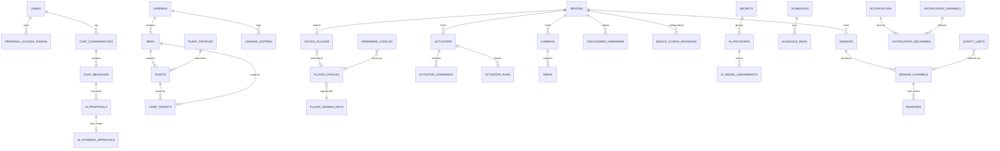
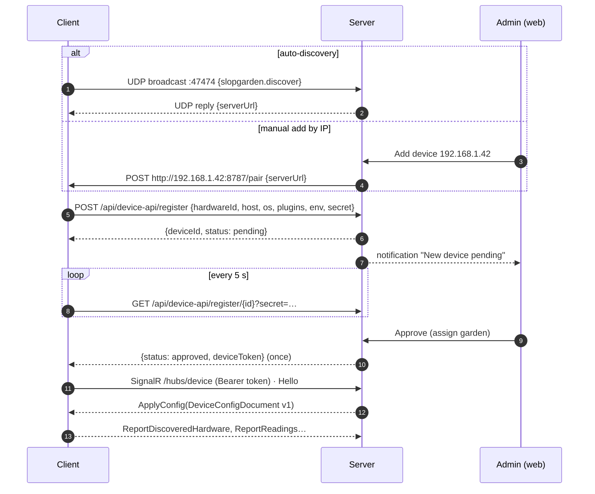

# SlopGarden — Software Architecture Plan

Status: revised for Milestone 1 · Date: 2026-10-24 · Source of truth for decisions: the project context (user decisions)

SlopGarden automates growing food in raised beds, garden beds, in-ground plots, containers and greenhouses, at any scale. The user runs the **SlopGarden Server** on a desktop on their LAN, opens the React web app, approves **SlopGarden devices** (any machine running the SlopGarden client, typically a Raspberry Pi) and then talks to an **AI agent** that sets up and operates the garden, asking for approval before it changes anything.

> This revision replaces the earlier cloud/SaaS draft (MQTT broker, TLS, device key pairs, TimescaleDB, multi-tenant accounts). Those ideas are kept only where they still fit, as "later" notes.

## 0. Decisions at a glance

| Area | Decision |
|---|---|
| Runtime | .NET 10 LTS for server, client, emulator and tools; one monorepo, one solution (`SlopGarden.slnx`); Apache-2.0 |
| Hosting | Self-hosted. The server runs on a typical desktop (Windows/macOS/Linux) on the user's LAN. Local network only for now |
| Transport | Plain HTTP + WebSockets on the LAN, **no transport encryption yet** (data is not sensitive). All URLs are configurable so TLS/reverse proxy can be added later without protocol changes |
| Device ↔ server | **SignalR hub** (`/hubs/device`, WebSocket) for config push, commands, readings, events; **HTTP** for registration and camera frame upload. No external broker |
| Server ↔ browser | REST (`/api/*`, OpenAPI) + SignalR hub (`/hubs/live`) for live readings, AI status, chat streaming, notifications |
| Backend | ASP.NET Core modular monolith; EF Core + Npgsql |
| Database | **PostgreSQL** (any reachable instance; connection parameters configurable by Admin). Plain tables; TimescaleDB optional later for long-range aggregates |
| Frontend | **React** + TypeScript + Vite + Mantine, served by the server (same origin, cookie auth) |
| Auth | Local accounts, cookie sessions; roles **Admin / ReadWrite / ReadOnly**; **PATs** (bearer) for MCP and API; device tokens for clients |
| Device onboarding | LAN auto-discovery (UDP broadcast) or manual add by IP → device is **pending** until an Admin approves → credential generated on approval |
| AI | OpenAI-compatible Chat Completions with tool calling; bring your own endpoint/model (OpenAI, LM Studio, Ollama, …); different models per job |
| AI tool surface | A single **tool registry** exposed both to the built-in assistant and as an **MCP server** (`/mcp`, Streamable HTTP, PAT auth), documented on an in-app page |
| Approvals | Every AI change is a **proposal** (what + why + diff) approved or rejected in chat; "always allow" creates a **standing approval** so routine actions run autonomously afterwards |
| Safety | Hard safety limits resolved per actuator and **enforced on the client and the server**; emergency stops at every level |
| Plugins | Sensor, actuator and camera plugin frameworks; built-in + external assemblies; signed plugin catalog in PostgreSQL; unsigned allowed with a warning |
| Notifications | Discord webhook + browser notifications behind a channel interface; mutes per plant/bed/device |
| Secrets | Model API keys, search keys and Discord webhooks are encrypted at rest (ASP.NET Data Protection) |
| Client | .NET Worker Service, `AddSystemd()` + `AddWindowsService()`, self-contained publish for `linux-arm64` (primary), `linux-x64`, `win-x64`, `osx-arm64`; 64-bit OS only |
| Testing without hardware | **Sensor emulator** process with a REST API to change every signal, physical coupling (valve on → moisture rises) and a static-image camera |

---

## 1. System overview

```mermaid
flowchart LR
  subgraph LAN["User's LAN"]
    subgraph Desktop["Desktop (Windows / macOS / Linux)"]
      API[SlopGarden Server<br/>ASP.NET Core<br/>REST · /hubs/live · /hubs/device · /mcp<br/>AI agent · scheduler · notifications]
      WEB[React web app<br/>served by the server]
      DB[(PostgreSQL<br/>local or remote)]
      API --- DB
    end
    subgraph Pi["Raspberry Pi (one or many)"]
      C[SlopGarden Client<br/>Worker Service<br/>plugins · safety guard · scheduler · outbox]
      HW[GPIO / I²C / SPI / 1-Wire<br/>USB serial (Arduino ADC)<br/>Bluetooth later]
      CAM[Camera]
      C --- HW
      C --- CAM
    end
    EMU[Sensor emulator<br/>REST API + control page<br/>fake camera image]
    C2[Client using emulator plugins] --- EMU
    BROWSER[Browser]
  end
  LLM[OpenAI-compatible endpoint<br/>OpenAI / LM Studio / Ollama]
  EXT[External AI apps<br/>MCP clients with a PAT]
  DISCORD[Discord webhook]

  C <-- "SignalR /hubs/device + HTTP" --> API
  C2 <-- "SignalR /hubs/device + HTTP" --> API
  BROWSER <-- "HTTP + SignalR /hubs/live" --> API
  API -- "chat completions + tools" --> LLM
  EXT -- "MCP (Streamable HTTP)" --> API
  API -- notifications --> DISCORD
```

### Components

| Component | Project | Responsibility |
|---|---|---|
| Server | `src/SlopGarden.Server` | Accounts/roles/PATs, gardens/beds/plants, device registry & approval, config generation, telemetry ingest, commands, safety resolution, schedules, AI agent, MCP server, notifications, hosts the web app |
| Web app | `src/web` (React) | Dashboard, garden/bed/plant editors, devices, automation, safety, chat with approvals, settings, MCP docs |
| Client | `src/SlopGarden.Client` | Runs on each device: plugins, sampling, calibration, outbox, safety guard, local schedules, cameras, discovery |
| Plugin SDK | `src/SlopGarden.Plugins.Abstractions` | Interfaces for sensor/actuator/camera plugins and hardware discovery |
| Plugins | `src/SlopGarden.Plugins.Hardware`, `src/SlopGarden.Plugins.Emulator`, `samples/plugins/*` | GPIO digital in, relay, ADS1115, DS18B20, BME280, Arduino serial ADC; emulator sensor/actuator/camera; sample external HTTP-JSON plugin |
| Contracts | `src/SlopGarden.Contracts` | Device protocol, desired config document, vocabulary, plugin signing |
| Emulator | `src/SlopGarden.Emulator` | Virtual garden: signal models, overrides, physical coupling, static camera, REST API + control page |
| Dev LLM | `tools/SlopGarden.DevLlm` | Deterministic OpenAI-compatible stub used for tests/demos when no real model is configured |

---

## 2. Data model (top priority — it feeds the AI)

Design rules:

1. **Sandbox model.** Gardens contain beds; beds contain plants. Sensors, actuators and cameras are attached to a device (where they are wired) and **target** a garden, a bed or a single plant (what they measure/serve). The user — or the AI — chooses the target.
2. **Everything the user can configure, the AI can configure** (through the same service layer), and every AI change is traceable to a proposal.
3. **Open vocabularies** (metrics, actuator kinds, plugin ids) are strings with well-known values, so plugins can add new ones without schema changes.
4. **Narrow time-series tables** (`readings`, `actuator_runs`) handle any number of sensor types.
5. **AI context fields** (`ai_context`) on gardens, beds and plants hold user-written notes the AI must respect ("this bed floods after rain", "kids pick strawberries here").
6. All tables use `uuid` primary keys (except append-only series), `created_at`/`updated_at` timestamps (UTC), snake_case names.

### 2.1 Entity relationship overview



"Target" columns (`target_type` + `garden_id`/`bed_id`/`plant_id`) are shown in the tables below rather than in the diagram.

### 2.2 Users, access and audit

| Table | Columns (type) | Notes |
|---|---|---|
| `users` | id, username (unique, citext-like lower), display_name, email?, password_hash, role (`admin`\|`read_write`\|`read_only`), is_disabled, created_at, last_login_at | First run creates the initial Admin. ReadOnly sees everything ReadWrite sees |
| `personal_access_tokens` | id, user_id → users, name, token_prefix (first 8 chars, for display), token_hash (SHA-256), scopes (text[]: `read`, `propose`, `write`), created_at, expires_at?, last_used_at?, revoked_at? | Bearer tokens for MCP/API. Effective permission = min(user role, scopes) |
| `audit_log` | id (bigserial), at, actor_type (`user`\|`ai`\|`pat`\|`device`\|`system`\|`schedule`), actor_id?, actor_label, action, target_type, target_id?, details (jsonb) | Every mutation, approval, command and estop |

### 2.3 Settings and secrets

| Table | Columns | Notes |
|---|---|---|
| `server_settings` | key (pk), value (jsonb), updated_at, updated_by? | Site name, units, AI context-window size, web search provider, default AI autonomy, discovery on/off, server public URL |
| `secrets` | id, name (unique), purpose (`ai_api_key`\|`search_api_key`\|`discord_webhook`\|…), ciphertext (text), created_at, updated_at | Encrypted with ASP.NET Data Protection (keys in the server data directory). Never returned by the API — only "set/not set" |

The **database connection itself** is not stored in the database: Admins edit it in *Settings → Server*, which writes `slopgarden.server.json` in the server data directory (host, port, database, username, password, SSL mode, extra parameters) and asks for a restart.

### 2.4 Garden domain

| Table | Columns | Notes |
|---|---|---|
| `gardens` | id, name, description, environment (`outdoor`\|`indoor`\|`greenhouse`\|`mixed`), location_source (`device`\|`manual`), latitude?, longitude?, elevation_m?, location_label?, timezone_id, timezone_source (`device`\|`manual`), hardiness_zone?, climate_notes?, ai_context, ai_autonomy (`propose_all`\|`standing_approvals`), created_at, updated_at, archived_at? | Location/timezone are inherited from the first approved client unless manually overridden. Season is derived from date + hemisphere |
| `beds` | id, garden_id → gardens, name, kind (`raised_bed`\|`in_ground`\|`container`\|`greenhouse_bench`\|`hydroponic`\|`vertical`\|`orchard_row`\|`other`), environment? (overrides garden), width_cm?, length_cm?, depth_cm?, soil_type?, soil_notes?, irrigation_type (`drip`\|`sprinkler`\|`soaker`\|`manual`\|`hydroponic`\|`none`), sun_exposure (`full_sun`\|`part_sun`\|`part_shade`\|`full_shade`\|`grow_light`), layout_x?, layout_y?, ai_context, notes, created_at, updated_at, archived_at? | Any growing situation: one pot or a 100 m field row is a bed |
| `plant_profiles` | id, slug (unique), common_name, scientific_name?, family?, category (`vegetable`\|`fruit`\|`herb`\|`flower`\|`other`), description, water_need (`low`\|`medium`\|`high`), soil_moisture_min_pct?, soil_moisture_max_pct?, light_hours_min?, light_hours_max?, dli_min?, air_temp_min_c?, air_temp_max_c?, soil_temp_min_c?, humidity_min_pct?, humidity_max_pct?, ph_min?, ph_max?, ec_min?, ec_max?, fertilizer_notes?, days_to_germination?, days_to_maturity_min?, days_to_maturity_max?, spacing_cm?, frost_tolerance (`none`\|`light`\|`hard`), sources (jsonb: citations/URLs the AI used), is_builtin, created_by_type (`user`\|`ai`\|`system`), created_at, updated_at | Crop knowledge. Seeded with common crops; the AI can create/tweak profiles from research |
| `plants` | id, bed_id → beds, plant_profile_id? → plant_profiles, name, variety?, quantity (int, a planting may be a group), layout_x?, layout_y?, stage (`planned`\|`seed`\|`germinating`\|`seedling`\|`vegetative`\|`flowering`\|`fruiting`\|`harvesting`\|`dormant`\|`removed`), started_from (`seed`\|`transplant`\|`cutting`\|`unknown`), planted_at? (date), expected_harvest_start?, expected_harvest_end?, harvest_prediction_notes?, ai_context, notes, created_at, updated_at, removed_at? | One row per plant or per planting group |
| `care_targets` | id, scope_type (`bed`\|`plant`), bed_id?, plant_id?, metric (e.g. `soil_moisture_pct`, `air_temperature_c`, `light_hours`, `ph`), min_value?, max_value?, ideal_value?, source (`profile`\|`user`\|`ai`), rationale?, updated_by_type, updated_by_id?, updated_at | Per-plant/per-bed overrides of the profile ranges. One row per metric so the AI can tune exactly one thing. Unique (scope, metric) |
| `journal_entries` | id, garden_id, bed_id?, plant_id?, kind (`note`\|`sown`\|`transplanted`\|`watered`\|`fertilized`\|`pruned`\|`pest`\|`disease`\|`harvest`\|`observation`\|`stage_change`), occurred_at, quantity?, unit?, notes, media_id? → media, created_by_type (`user`\|`ai`\|`system`), created_by_id?, created_at | Growth history; harvest entries feed predictions and reports |

### 2.5 Devices and plugins

| Table | Columns | Notes |
|---|---|---|
| `devices` | id, name, hardware_id (unique; stable id reported by the client), hostname, status (`pending`\|`approved`\|`rejected`\|`revoked`), discovered_via (`broadcast`\|`manual_ip`\|`configured`), ip_address?, local_endpoint? (client's local API, used for manual add), os, architecture, client_version, garden_id? (default garden for new components), registration_secret_hash, credential_hash?, credential_issued_at?, approved_by?, approved_at?, reported_timezone_id?, reported_utc_offset_min?, reported_latitude?, reported_longitude?, reported_location_label?, desired_config_version, applied_config_version?, config_errors (jsonb), last_seen_at?, is_online, buffered_readings, created_at, updated_at | The device token is shown to the client once on approval; only its hash is stored. Revoking forces re-registration |
| `device_config_revisions` | id, device_id, version, document (jsonb: `DeviceConfigDocument`), created_at, applied_at?, success?, errors (jsonb) | Audit trail of what each device was told to run |
| `device_plugins` | id, device_id, plugin_id, version, display_name, kinds (text[]), sha256, source (`builtin`\|`external`), trust (`builtin`\|`signed`\|`unsigned`\|`invalid`), publisher?, signature_key_id?, catalog_entry_id? → plugin_catalog, reported_at | What is actually installed. UI warns on `unsigned`/`invalid` |
| `discovered_hardware` | id, device_id, plugin_id, kind (`sensor`\|`actuator`\|`camera`), address, suggested_name, suggested_settings (jsonb), channels (jsonb), actuator_kind?, adopted_component_id?, reported_at | From I²C scans, 1-Wire enumeration, emulator inventory. One click (or one AI proposal) adopts it |
| `plugin_signing_keys` | id, key_id (unique, short SHA-256 of SPKI), publisher, algorithm (`ecdsa-p256-sha256`), public_key_spki (base64), status (`active`\|`revoked`), created_at, revoked_at? | Trusted publishers (model: signed drivers). Pushed to clients |
| `plugin_catalog` | id, plugin_id, version, display_name, publisher, kinds (text[]), description, sha256, signature (base64), signing_key_id → plugin_signing_keys, status (`approved`\|`pending`\|`revoked`), homepage_url?, settings_schema (jsonb), approved_at?, created_at | Approved/signed plugin builds. A device plugin whose (plugin_id, version, sha256) matches an approved row is "Signed — in catalog" |
| `hardware_catalog` | id, kind (`sensor`\|`actuator`\|`camera`\|`bridge`), manufacturer, model, protocol (`gpio`\|`i2c`\|`spi`\|`one_wire`\|`usb_serial`\|`ble`\|`analog`\|`csi`\|`http`), metrics (text[]), plugin_id, recommended (bool), tested_status (`tested`\|`community`\|`untested`), notes, datasheet_url?, created_at | Curated list of compatible and recommended hardware (ADS1115, DS18B20, BME280, capacitive soil probe v2, relay board, Arduino Nano ADC bridge, Pi camera…) |
| `client_releases` | id, version, rid, sha256, size_bytes, file_path, notes, published_at | Updates come from the server (later milestone) |
| `device_updates` | id, device_id, release_id, status (`available`\|`approved`\|`downloading`\|`installed`\|`failed`\|`rejected`), approved_by?, approved_at?, finished_at?, error? | Every update needs user approval |

### 2.6 Sensors, actuators, cameras and telemetry

Every component has a **target**: `target_type` (`garden`\|`bed`\|`plant`) plus nullable `garden_id`, `bed_id`, `plant_id` (exactly the one matching `target_type` is required; `garden_id` is always filled for fast filtering).

| Table | Columns | Notes |
|---|---|---|
| `sensors` | id, device_id → devices, name, plugin_id, hardware_catalog_id?, settings (jsonb, plugin-specific: pin, address, emulator id…), read_interval_sec, enabled, target_type, garden_id, bed_id?, plant_id?, status (`ok`\|`error`\|`stale`\|`disabled`), last_error?, created_at, updated_at | A sensor is one physical device; it produces one or more channels |
| `sensor_channels` | id, sensor_id → sensors, key (plugin channel key), metric, unit, display_name?, calibration (jsonb: `CalibrationConfig`), calibration_status (`uncalibrated`\|`calibrated`\|`ai_calibrated`), calibrated_at?, min_valid?, max_valid?, alert_low?, alert_high?, last_value?, last_raw_value?, last_quality?, last_value_at? | `last_*` is the dashboard's "latest value" cache |
| `readings` | channel_id → sensor_channels, time (timestamptz), value (double), raw_value?, quality (smallint) — **PK (channel_id, time)** | Narrow series, idempotent ingest (`ON CONFLICT DO NOTHING`). Range partitioning / TimescaleDB later |
| `actuators` | id, device_id, name, kind (`pump`\|`valve`\|`light`\|`heater`\|`fan`\|`fertilizer_doser`\|`mister`\|`other`), plugin_id, settings (jsonb), enabled, failsafe_state (`off`\|`on`), flow_rate_ml_per_min?, target_type, garden_id, bed_id?, plant_id?, is_on, level?, state_since?, status, last_error?, created_at, updated_at | |
| `actuator_commands` | id, actuator_id, action (`on`\|`off`\|`pulse`\|`dose`), duration_sec?, amount_ml?, level?, reason, requested_by_type (`user`\|`ai`\|`schedule`\|`pat`\|`system`), requested_by_id?, proposal_id?, schedule_id?, status (`pending`\|`blocked`\|`sent`\|`received`\|`running`\|`completed`\|`rejected`\|`failed`\|`expired`\|`cancelled`), blocked_reason?, created_at, sent_at?, completed_at?, expires_at | Server-side safety check before sending; the client re-checks |
| `actuator_runs` | id (client-generated uuid, idempotent), actuator_id, command_id?, schedule_id?, started_at, ended_at, duration_sec, amount_ml?, source (`command`\|`schedule`\|`manual`), stop_reason? | Source of truth for "per day" limits and watering history (includes offline schedule runs) |
| `cameras` | id, device_id, name, plugin_id, settings (jsonb), capture_width, capture_height, frame_interval_sec, enabled, target_type, garden_id, bed_id?, plant_id?, last_frame_at?, status, created_at, updated_at | The live feed is the latest frame; per-view resolution is chosen by the viewer (`?width=`) and rescaled server-side |
| `media` | id, kind (`camera_frame`\|`ai_capture`\|`user_upload`\|`report_image`), camera_id?, garden_id?, bed_id?, plant_id?, content_type, width, height, size_bytes, data (bytea), captured_at, retain_until? | AI on-demand captures, growth snapshots, report images. Live frames are kept in memory; periodic snapshots are persisted |
| `device_events` | id (bigserial), device_id, time, severity (`info`\|`warning`\|`critical`), category (`safety`\|`sensor`\|`actuator`\|`camera`\|`plugin`\|`system`), message, sensor_id?, actuator_id?, camera_id? | Faults, safety cutoffs, plugin warnings |

### 2.7 Automation and safety

| Table | Columns | Notes |
|---|---|---|
| `schedules` | id, garden_id, name, kind (`actuator`\|`ai_review`\|`report`\|`camera_snapshot`), cron (5-field), timezone_id, actuator_id?, duration_sec?, amount_ml?, target_type?, bed_id?, plant_id?, payload (jsonb, e.g. review prompt or report options), enabled, created_by_type (`user`\|`ai`), created_by_id?, proposal_id?, last_run_at?, next_run_at?, created_at, updated_at | `actuator` schedules run **on the client** (offline-safe). `ai_review` controls **how often data is sent to the model**. `report` generates scheduled reports |
| `schedule_runs` | id, schedule_id, started_at, finished_at?, status (`running`\|`succeeded`\|`failed`\|`skipped`), details (jsonb) | Server-side runs (AI reviews, reports) |
| `safety_limits` | id, scope_type (`global`\|`garden`\|`bed`\|`plant`\|`device`\|`actuator`), scope_id?, limit_type, actuator_kind? (applies to one kind, e.g. `fertilizer_doser`), value (double), channel_id? → sensor_channels, operator? (`lt`\|`gt`), enabled, notes, created_by_type, created_by_id?, proposal_id?, created_at, updated_at | `limit_type`: `max_run_seconds`, `max_daily_run_seconds`, `min_seconds_between_runs`, `max_daily_amount_ml` (fertilizer), `tank_low_lockout` (channel lt value), `max_temperature_cutoff` (channel gt value; heaters/lights), `min_temperature_cutoff`. The **effective** limit per actuator is the most restrictive across global → garden → bed → plant → device → actuator |
| `emergency_stops` | id, scope_type (`global`\|`garden`\|`bed`\|`plant`\|`device`\|`actuator`), scope_id?, active, reason, activated_by_type, activated_by_id?, activated_at, released_by_id?, released_at? | Any user (or the AI, without approval) can **stop**; **releasing** needs ReadWrite and, from the AI, an approved proposal |

### 2.8 AI

| Table | Columns | Notes |
|---|---|---|
| `ai_providers` | id, name, base_url (OpenAI-compatible, e.g. `https://api.openai.com/v1`, `http://localhost:1234/v1`, `http://localhost:11434/v1`), api_key_secret_id? → secrets, default_model, created_at, updated_at | Bring your own model |
| `ai_model_assignments` | job (pk: `chat`\|`scheduled_review`\|`vision`\|`reports`\|`calibration`), provider_id, model, temperature?, max_output_tokens?, context_message_limit | Different models for different jobs; the context limit caps tokens sent |
| `chat_conversations` | id, user_id, title, garden_id?, last_page_context (jsonb), created_at, updated_at, archived_at? | Kept permanently |
| `chat_messages` | id, conversation_id, seq (int), role (`user`\|`assistant`\|`tool`\|`event`), content (markdown), tool_calls (jsonb), tool_call_id?, tool_name?, page_context (jsonb), proposal_id?, provider_id?, model?, prompt_tokens?, completion_tokens?, error?, created_at | `event` = approvals/rejections/execution results shown inline. Only the last *N* messages (per assignment) are sent to the model |
| `ai_proposals` | id, conversation_id?, message_id?, origin (`chat`\|`schedule`\|`mcp`), requested_by_type, requested_by_id?, tool_name, arguments (jsonb), title (**what**), rationale (**why**), changes (jsonb: field-level before/after), target_type, target_id?, garden_id?, risk (`low`\|`medium`\|`high`), status (`pending`\|`approved`\|`rejected`\|`executed`\|`failed`\|`expired`), decided_by?, decided_at?, decision_note?, executed_at?, result (jsonb), created_at, expires_at? | The approval prompt in chat |
| `ai_standing_approvals` | id, tool_name, target_type, target_id?, constraints (jsonb, e.g. `{ "maxDurationSec": 120 }`), created_from_proposal_id?, approved_by, created_at, revoked_at? | "Always allow" — already-approved routine actions the AI may repeat autonomously (always still subject to safety limits) |
| `ai_activities` | id, garden_id?, target_type, target_id?, kind (`thinking`\|`tool`\|`command`\|`review`), summary, status (`running`\|`succeeded`\|`failed`), conversation_id?, proposal_id?, command_id?, started_at, finished_at? | Drives the dashboard "AI is acting on this plant" indicator |

### 2.9 Notifications

| Table | Columns | Notes |
|---|---|---|
| `notification_channels` | id, kind (`discord`\|`browser`), name, secret_id? (webhook URL), settings (jsonb), min_severity, categories (text[]), enabled, created_at | New channel kinds plug into an `INotificationSender` interface |
| `notifications` | id, garden_id?, severity, category (`device`\|`sensor`\|`safety`\|`ai`\|`schedule`\|`report`\|`system`), title, body (markdown), target_type?, target_id?, dedupe_key?, created_at, read_at? | Browser channel = live push over `/hubs/live` + the Notification API |
| `notification_deliveries` | id, notification_id, channel_id, status (`sent`\|`failed`\|`suppressed`), attempted_at, error? | |
| `notification_mutes` | id, scope_type (`garden`\|`bed`\|`plant`\|`device`\|`sensor`), scope_id, category?, muted_until? (null = until unmuted), reason?, created_by, created_at | Mute per plant and per client to stop repeat alerts |

---

## 3. Device lifecycle and protocol



- **Hub messages** (`DeviceHubMethods`): client → server `Hello`, `ReportReadings` (acked), `ReportActuatorState`, `ReportActuatorRun`, `AckCommand`, `ReportEvent`, `ReportConfigApplied`, `ReportDiscoveredHardware`; server → client `ApplyConfig`, `ExecuteCommand`, `CaptureFrame`, `EmergencyStop`, `RequestDiscovery`. Camera frames go over HTTP (`POST /api/device-api/cameras/{id}/frames`).
- **Desired config** (`DeviceConfigDocument`): versioned; includes sensors + channels + calibration, actuators + **effective safety limits and interlocks**, cameras, approved actuator schedules, emergency-stop state, client settings and trusted plugin keys. The client caches it, so **offline it keeps running the last approved schedules and rules**; readings, runs and acks are buffered in a SQLite outbox and flushed on reconnect.
- **Location and time** are reported by the client (`DeviceEnvironmentInfo`) and inherited by the garden unless manually overridden.
- **Updates** (later milestone): the server publishes client releases; each device update needs explicit user approval.

## 4. Plugin frameworks

- **Interfaces** (`SlopGarden.Plugins.Abstractions`): `ISensorPlugin` → `ISensor.ReadAsync()` (raw readings per channel key), `IActuatorPlugin` → `IActuator.SetStateAsync(on, level)`, `ICameraPlugin` → `ICamera.CaptureAsync(width, height)`, optional `IHardwareDiscovery`. Each component publishes a JSON-Schema for its settings, which the web UI renders as a form and the AI reads through MCP.
- **Loading**: built-in plugins are compiled into the client; external plugins are folders (`plugin.json` + assemblies) in the plugins directory, loaded into an isolated `AssemblyLoadContext` that shares the abstractions with the host. No code changes are needed to add hardware support.
- **Calibration** lives in the channel config, not the plugin: raw → value via linear / two-point / polynomial. The guided UI wizard and the AI both write the same `calibration` JSON.
- **Signing**: a publisher signs `(pluginId, version, sha256)` with ECDSA P-256 (`plugin.sig.json`). Trusted keys and approved builds live in `plugin_signing_keys` / `plugin_catalog`. Trust levels: `builtin`, `signed`, `unsigned` (allowed, with a prominent warning that security can't be guaranteed), `invalid` (refused).
- **Analog input**: ADS1115 over I²C (default, near the Pi) and Arduino/ESP32 over USB serial (remote/many channels) are both plugins; I²C, SPI and 1-Wire buses are reached through `System.Device.Gpio`/`Iot.Device.Bindings`.

## 5. Safety model

1. **Resolution** (server): for each actuator, collect enabled `safety_limits` from global → garden → bed → plant → device → actuator (filtered by `actuator_kind`), keep the most restrictive value per numeric limit type and all interlocks.
2. **Server check** before sending any command (estop, per-run, per-day from `actuator_runs`, min interval, daily dose, interlocks on the latest channel values). A blocked command is stored with `blocked_reason` and reported to the caller (user or AI).
3. **Client enforcement**: the same limits ship in the config document; the client `SafetyGuard` caps durations, refuses commands, and turns running actuators off when an interlock trips — even when offline or if the server misbehaves.
4. **Emergency stops** at global/garden/bed/plant/device/actuator level are pushed immediately; the client forces failsafe state and refuses commands until released.
5. **AI and limits**: the AI can read limits and *propose* changing them; changes require approval like any other proposal.

## 6. AI agent, tools and MCP

- **One tool registry**, generated from C# input/output types (JSON Schema via `System.Text.Json.Schema`), each tool marked *read* or *mutating* with a minimum role. Roughly 50 tools covering gardens, beds, plants, plant profiles, care targets, journal, devices, discovered hardware, sensors/channels/calibration, readings, actuators/commands, cameras/captures, schedules, safety limits, emergency stops, notifications/mutes, plugins, hardware catalog, proposals, environment context (date/time/season/location) and web search.
- **Built-in assistant**: `POST /api/chat/conversations/{id}/messages` stores the message and runs the agent loop in the background, streaming deltas, tool calls and proposals to the browser over `/hubs/live`. The system prompt contains a compact garden snapshot, the current page context (the assistant defaults to what the user is looking at), safety rules and approval rules. Only the last *N* messages are sent.
- **Proposals**: when the model calls a mutating tool, the server does not execute it. It records an `ai_proposal` with **what** (title + field-level diff) and **why** (the model must pass a `reason`), and the chat renders an Approve/Reject card. On approval the tool runs with the approver's permissions and the result is appended to the conversation. "Always allow" stores a standing approval so routine repeats run autonomously (still subject to safety limits); the dashboard shows the AI activity indicator while it acts.
- **MCP server**: `/mcp` implements MCP over Streamable HTTP (JSON-RPC: `initialize`, `tools/list`, `tools/call`, `ping`) with `Authorization: Bearer <PAT>`. PAT scopes: `read`, `propose` (mutations become proposals), `write` (execute directly, if the user's role allows). The *MCP tools* page documents every tool's name, description, input schema and output schema, and shows connection snippets.
- **Model jobs**: `chat`, `scheduled_review` (periodic garden review driven by `ai_review` schedules), `vision` (camera captures — the AI requests a still via `capture_camera_image`; no continuous video), `reports`, `calibration`.
- **Web search**: one `web_search` tool, routed per AI job. When the job's model runs on the OpenAI API (base URL host `api.openai.com`, key stored — any model, so new OpenAI models work without changes), the search runs through **OpenAI's built-in `web_search` tool** (Responses API) and returns a cited summary. Otherwise (bring-your-own model: LM Studio, Ollama, other compatible endpoints) it uses the custom provider (SearXNG, Tavily, Brave; key stored as a secret). The custom provider is also the fallback when the native call fails, and Admins can force it for OpenAI too. Settings → AI shows the active mode per job.

## 7. Server, web app, deployment

- **Server layout**: `Data/` (EF Core DbContext + entities), `Services/` (domain services shared by REST and tools), `Endpoints/` (minimal APIs), `Hubs/` (`DeviceHub`, `LiveHub`), `Ai/` (provider client, agent loop, tool registry), `Mcp/`, `Notifications/`, `Discovery/`, `Background/` (offline detection, server-side schedules, retention).
- **Configuration**: `appsettings.json` → `slopgarden.server.json` (data dir, written by the Admin settings page) → environment variables (`SLOPGARDEN_…`). Database connection parameters are individually configurable for local, LAN or remote PostgreSQL.
- **Web app**: React + TypeScript + Vite + Mantine + TanStack Query + react-router + `@microsoft/signalr` + `react-markdown`. Pages: Dashboard, Garden/Bed/Plant detail, Devices (pending approvals, add by IP, plugin trust), Sensors & calibration, Actuators, Cameras, Automation (schedules), Safety (limits, emergency stops), Assistant (full page + side panel on every page), Approvals, Notifications, Settings (AI providers & model assignments, web search, notification channels, users, PATs, server/database, plugin catalog, hardware catalog), MCP tools docs. Same UX for a 1-pot balcony and a 1,000-plant farm: lists are searchable/paginated, the dashboard groups by garden and bed.
- **Run**: `dotnet run --project src/SlopGarden.Server` (serves the built web app); the client and emulator run as separate processes. A desktop installer/service wrapper and Docker Compose are later-milestone items.

## 8. Roadmap

| Milestone | Scope |
|---|---|
| **M1 (current)** | React web app; server + PostgreSQL; client service (Pi/systemd, Windows, macOS); sensor/actuator/camera plugin frameworks; AI chat (API key entry, markdown, approve/reject) backed by the MCP tool registry; sensor emulator with REST control and static camera; seeded virtual garden; tests |
| M2 | Guided calibration wizard + AI calibration; scheduled reports (growth, images, conditions, harvest predictions); notification rules engine; Discord rich embeds; client updates from server with approval |
| M3 | Real hardware bring-up on the user's Pi: GPIO/I²C/1-Wire validation, Arduino ADC bridge, Pi camera (libcamera) plugin, MJPEG live streaming |
| M4 | USB/Bluetooth transports, ESP32 satellite nodes, plugin catalog publishing workflow, hardware recommendations from testing |
| Later | TLS + internet access (reverse proxy / tunnel), TimescaleDB option, multi-site, mobile PWA polish, Home Assistant integration |
